<!-- Generated from readme.yml by LukeNeedham/ci-workflows (docs/readme.md). Edit readme.yml, not this file. -->
<p align="center">
  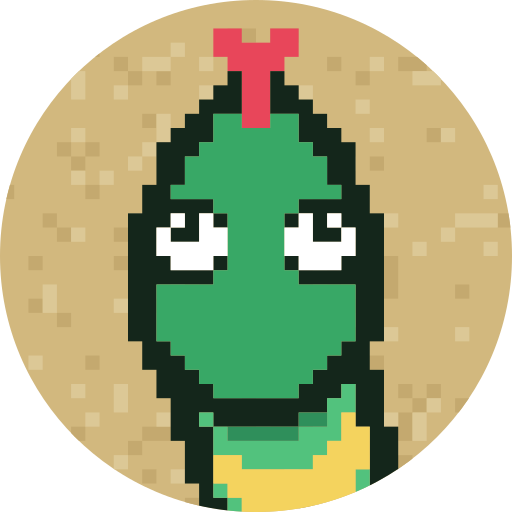
</p>

# Snake

Snake with a twist: one button, a snake that only ever turns, and poisonous toads.

## Description

Snake is a one-button arcade game in pixel art. The snake never goes straight: it circles around itself, and the only
thing you can do is tap to change the direction of the turn. Steer it by twisting out of its own spiral, bounce it off the
edge of the oval (a bounce turns it the other way too), and eat the mice that run out of the tall grass. Each mouse makes the snake one section longer, with
a skin pattern that repeats as it grows. The snake can cross its own body without harm: the only things that kill it are
hunger and the lupus curse.

Beware the toads that hop out of the grass: each colour is poisonous in its own way. One makes the whole screen wavy,
one turns every animal into a weird monster, one makes the snake so dizzy that it ignores your taps for a few seconds, and
the grey one puts the lupus curse on the snake: for a few seconds, touching itself is deadly.

Birds fly in from off the screen and land in the oval: blue tits, robins and sparrows, blackbirds, crows and pigeons. Each kind is
worth a little more than a mouse and gives the snake a different power up for a few seconds: it goes faster, sprints for less, is
sneakier, eats from further away, blows up every toad and keeps new ones away, or carries a piece of cheese that brings mice
running from all over (but with its mouth full, the snake cannot eat until the cheese is gone). Power ups stack with each other
and with the toads' poison. Birds are rare, only one at a time, and extremely skittish: they fly off the moment the snake gets
close, so catching one takes a sprint.

The snake is always hungry: a bar at the top of the screen runs down, a mouse fills it, a toad hardly does, and the
snake starves when it is empty. Hold the corner at the bottom left to sprint (you can move it to the right in the settings), which is faster but burns
the bar quicker, while your other thumb taps anywhere else to turn. The button at the top left pauses the game and opens a
menu with Resume, Restart and Settings.
The first time, the game opens with a story and a tutorial. The snake sleeps curled up on the raw stone floor of its house, a ring of
rocks in the grass, until the player taps to wake it. It wakes up, blinks, flicks its tongue, and its stomach rumbles; it dreams of a mouse,
and then it starts to circle. A tap turns it the other way. The path up to the oval is blocked by a pile of stones, so the player steers
it out by the wide path to the left, to the room of the tutorial: an oval of sand just like the stage. There it learns to hold the sprint
corner (to zoom), that the hunger bar goes down and a mouse that runs in from the grass fills it, that a toad that hops in poisons (the dizzy
one), and that a bird that flies in gives a power. Each is learned by doing it, and then an arrow shows the way back to the house, where
the stones are gone and an arrow shows the way up the path to the oval, which is one screen long: the house and the oval cannot be seen
from each other. Later games start with the snake waking in its house and the path up open. The snake can go home any time, and going
into the room of the tutorial again teaches the lessons again. A restart goes straight to the oval.

The mice run from a snake they see coming, but they cannot see what is behind them.

## Screenshots

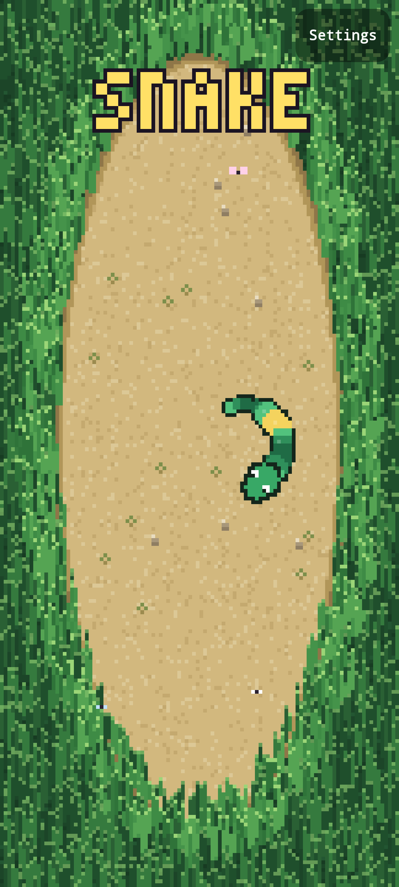
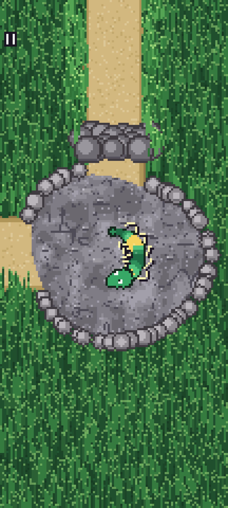
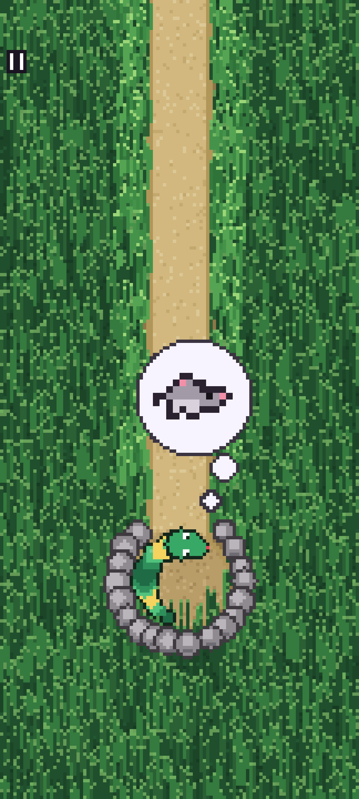
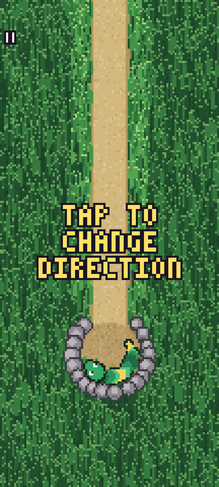
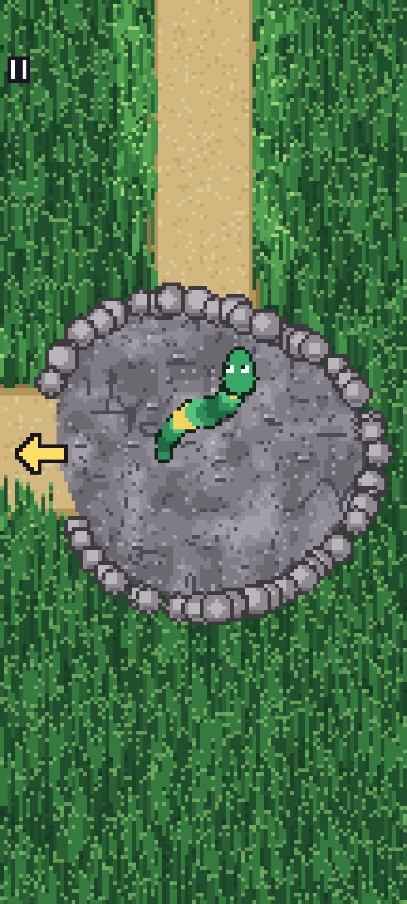
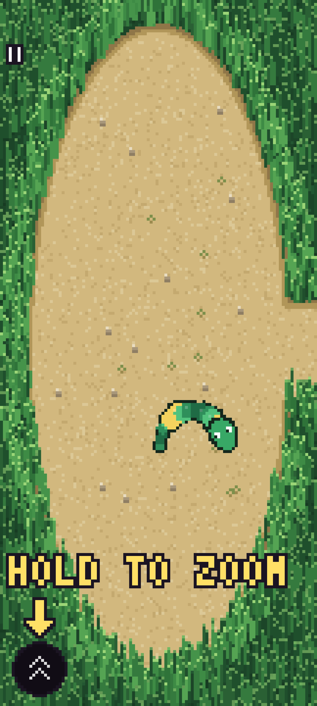
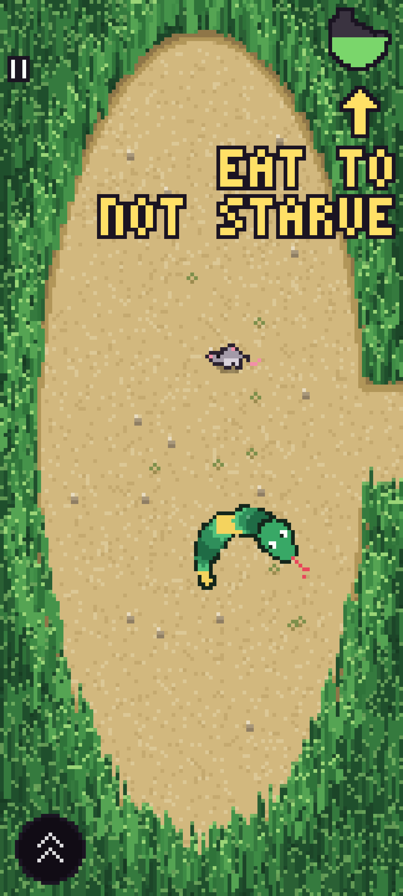
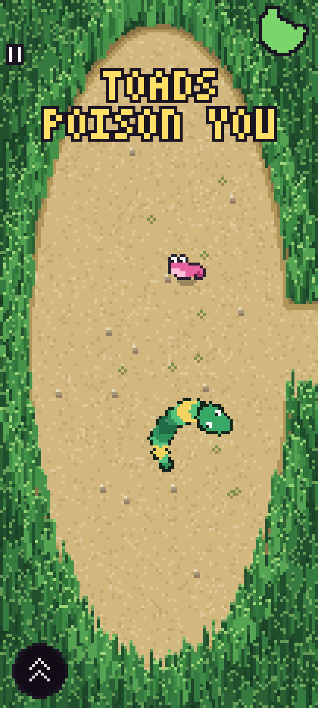
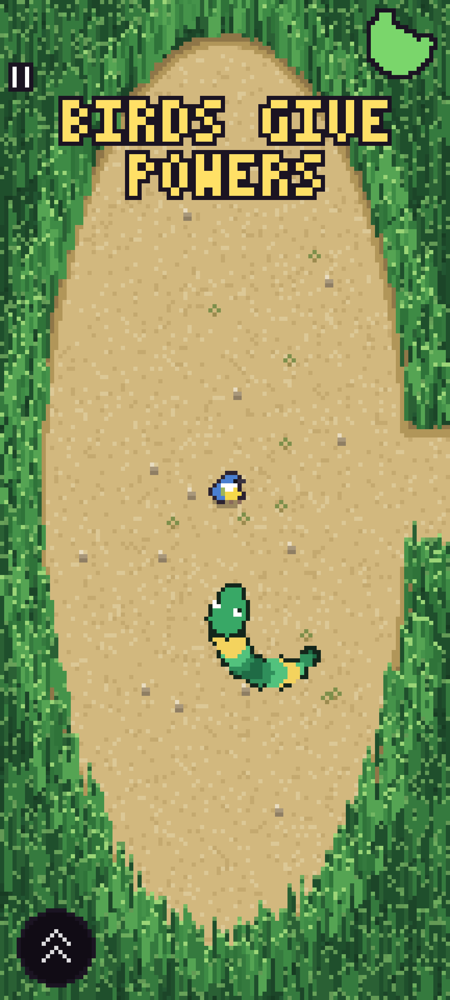
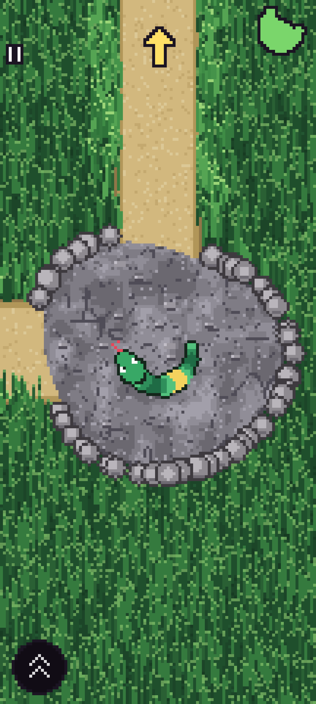
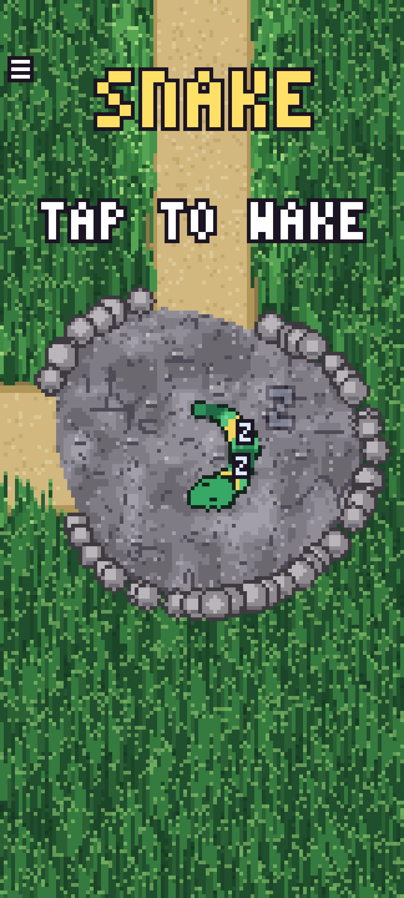
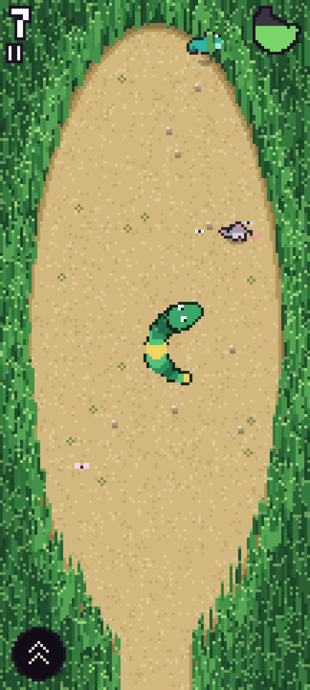
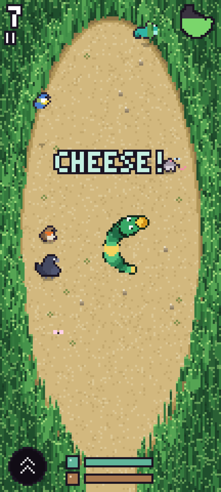
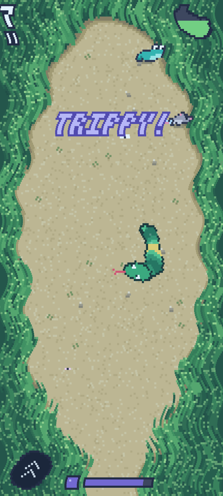
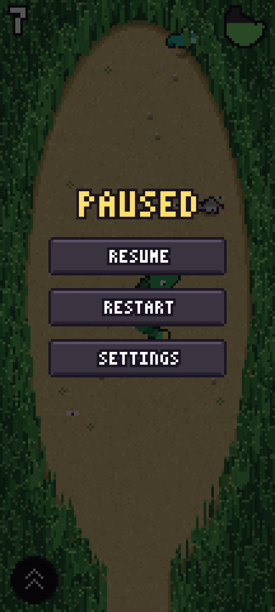
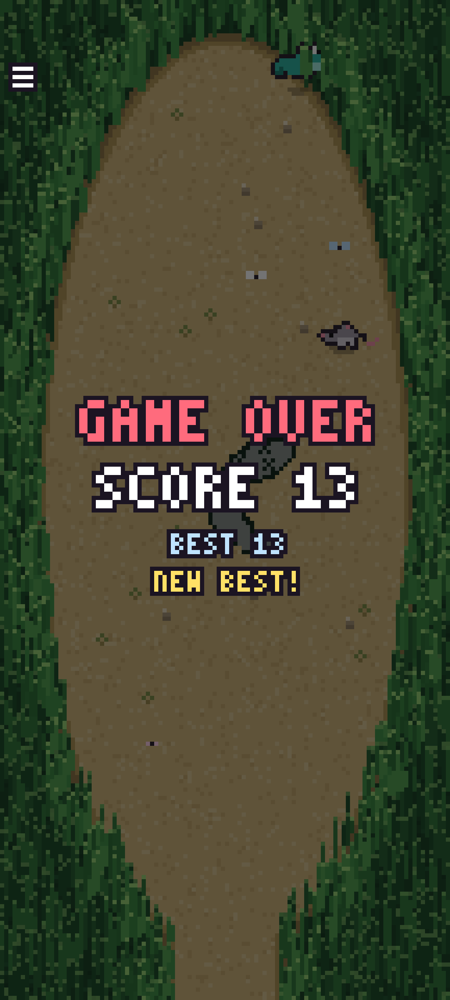

## Getting started as a user

1. Install the latest build from the [AppHub](https://www.lukeneedham.com/apphub) app, or download the APK from the [Releases](https://github.com/LukeNeedham/Snake/releases) page.

Requires Android 6.0 (API 23) or newer.

## Getting started as a developer

Requirements: JDK 17 and the Android SDK (platform 36), for example through Android Studio.

```
git clone https://github.com/LukeNeedham/Snake.git
cd Snake
./gradlew assembleDebug    # the APK is in app/build/outputs/apk/debug/
./gradlew test             # unit tests
```

Every pull request is built by CI, which comments on it with a link to install the APK.

Like all my apps, it follows the shared architecture and conventions (single activity, Jetpack Compose, Navigation 3, MVVM with every page split into a `Page` and a `PageContent`, Koin): see [ci-workflows](https://github.com/LukeNeedham/ci-workflows/blob/main/docs/new-app.md).

## Contributing

Branch from `main`, make the change, and open a pull request. CI must be green before it is merged.

## License

All rights reserved. See [LICENSE](LICENSE).
